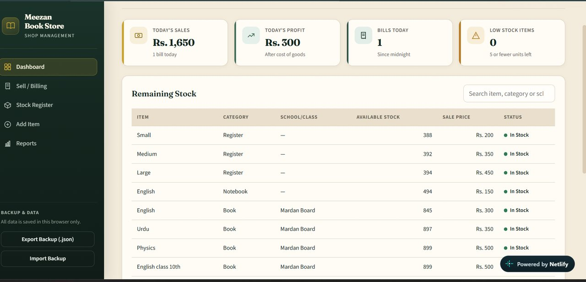

# Meezan Book Store — Management System

A shop management app for a book and stationery store, built with plain HTML, CSS and JavaScript. No frameworks and no backend: everything runs in the browser and the data is saved in `localStorage`.

It covers the daily work of a small shop: keeping a stock register, making bills for customers, and checking how much was sold and earned each day.



## Features

- **Dashboard**: today's sales, today's profit, number of bills, and a low-stock counter, plus a searchable list of remaining stock and the most recent bills
- **Sell / Billing**: pick items from the stock list, set the quantity, add them to a cart, apply a discount, and create the bill. The cart shows quantity × unit price for every item and the grand total
- **Customer details**: optional customer name, phone number and note on each bill
- **Receipts**: every bill opens as a receipt that can be printed
- **Stock Register**: all items with category, school/class, cost price, sale price, stock value and status. Search and filter by category, edit an item, or restock it
- **Add Item**: books, copies, registers, notebooks, guides, pens, pencils and other stationery, with an optional school/class field
- **Low-stock warning**: items with 5 or fewer units are flagged on the dashboard and in the register
- **Stock deduction**: stock goes down automatically when a bill is created
- **Reports**: all-time totals (sales, profit, bills, items sold) and a date-wise table
- **Backup**: export all data to a `.json` file and import it back
- **Responsive layout**: sidebar navigation on desktop and a slide-out menu on mobile

## Tech

- HTML5
- CSS3
- Vanilla JavaScript (ES6)
- Browser `localStorage` for data
- Google Fonts: Fraunces and Source Sans 3

## Project structure

```
book-store-management/
├── index.html        # page layout: dashboard, billing, stock, add item, reports, modals
├── css/
│   └── style.css     # styling and responsive rules
└── js/
    └── script.js     # app logic: storage, billing, stock, reports, backup
```

## Run it locally

No install is needed.

1. Download or clone this repository.
2. Open the folder in VS Code and start it with the **Live Server** extension, or just double-click `index.html`.

```bash
git clone https://github.com/MianHasnainAhmad/Book-Store-Management.git
```

## Good to know

- Data is stored **only in the browser you use**. Clearing the browser's site data deletes it, so use **Export Backup (.json)** from the sidebar now and then.
- Use **Import Backup** to move your data to another browser or computer.
- Quantity is changed through **Restock** in the Stock Register, not through the Edit form.

## Author

**Mian Hasnain Ahmad**
[GitHub](https://github.com/MianHasnainAhmad) · [LinkedIn](https://www.linkedin.com/in/mian-hasnain-951695325)
